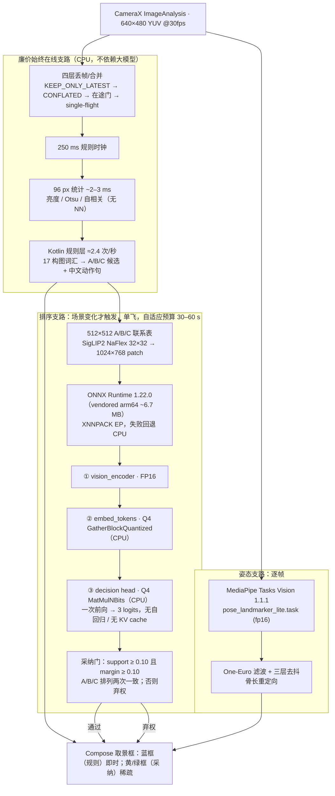

# 方案 001：端侧单芯片 VLM —— 手机 CPU 上的 600M 决策模型

> 所属：street-snap（途帧）相机 App。状态：v1 基线已冻结，模拟器实测（loaded-only），
> 真机（Honor Vs3）待测。本文是实现路径说明；原始细节见
> [pipeline v1](../../docs/on-device-composition-pipeline-v1.md)、
> [d1-omni case](../../docs/case-d1-omni-on-device.md)、
> [CPU playbook](../../docs/on-device-cpu-inference-playbook.md)。

## 1. 一句话方案

把生成式 VLM「看图说话」的需求**重塑为分类决策**：手机端纯本地、无云端跑一个 600M VLM，
不做自回归生成，而是在规则层给出的 3 个构图候选 A/B/C 上做**一次前向、输出 3 个 logits**，
配合显式弃权门决定是否采纳。姿态理解则交给始终在线的轻量 MediaPipe 支路。
这是全仓的方法论原点：先重塑问题，再谈 kernel 优化。

## 2. 架构图

## 3. 推理链路：一帧到一个决策

1. **取帧与降载**：CameraX `KEEP_ONLY_LATEST`；旧帧被替换、绝不排队（积压 = 观感卡顿）。
2. **廉价规则层先行**：96 px 缩略图做无 NN 统计，规则层每 ~400 ms 直接画蓝框给反馈，
   同时决定是否值得唤醒大模型；大模型只在 A/B/C 候选之间选一个或弃权。
3. **候选打包成一次前向**：三个候选拼一张 512×512 联系表，配固定 marker-choice prompt；
   SigLIP2 NaFlex 处理非方格图（32×32 → 1024×768 patch）。
4. **三段 ONNX 图，两种精度**：视觉塔 FP16 走 XNNPACK（2–4 线程）；embedding 与 decision
   head 为 Q4（`GatherBlockQuantized` / `MatMulNBits`，CPU）。无 KV cache、无输出长度方差、
   无输出解析——这是重塑问题后省掉的三大成本。
5. **显式采纳门**：support、margin、两次排列一致性三个条件全过才换黄框；不通过就弃权，
   保留规则层蓝框。宁可不给建议，不给错建议。
6. **姿态支路独立流动**：逐帧 landmarks → One-Euro 不规则时间戳滤波 → 可见性门限 +
   0.35 s hold-through + 三层 presence/pose 去抖 → 骨长重定向到教学人形。

## 4. 落地形态

| 维度 | 布置 |
| --- | --- |
| 应用形态 | 单 Android App（Kotlin 2.2.10 / CameraX / Compose，minSdk 31），无任何云端依赖 |
| 推理运行时 | MediaPipe Tasks Vision 1.1.1（姿态）；ONNX Runtime 1.22.0 vendored arm64 AAR（排序） |
| 模型交付 | **权重不进 APK**：d1-omni-600M-ONNX 11 文件 ~418 MiB，HuggingFace 运行时下载 + SHA-256 校验（LFS 存于 edge-model-solutions）；pose task 同样运行时下载 |
| 并发控制 | 排序支路单飞；`RunOptions.setTerminate` 协作式硬截止；自适应预算 `clamp(elapsed·1.5 + 2 s, 30–60 s)`，慢设备给更长截止**也**给更长休息；后台 session warm-up（2026-10-20） |
| 失败语义 | 超时/弃权一律降级为规则层蓝框，UI 永不阻塞在模型上 |

## 5. 边界与证据

- 现有全部时延数字来自**软件渲染模拟器**（loaded-only）：540×1170 一次排序 ~16–22 s；
  1080×2340 频繁触及 30 s 预算并按设计超时。**禁止外推到真机 SoC**（仓规）。
- 待办：真机实测、视觉塔 INT8 校准（替换 FP16）、warm-up 在真机的收益测量。
- 这个方案与 002 的关系：001 证明「端侧用重塑问题回避自回归」；002 在主机上研究
  「保留自回归时，云时代的 P/D 分离在单机成立到什么程度」——两者是同一问题的两端。
