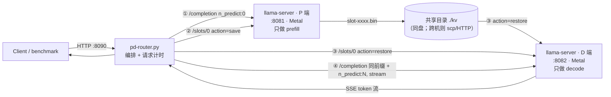
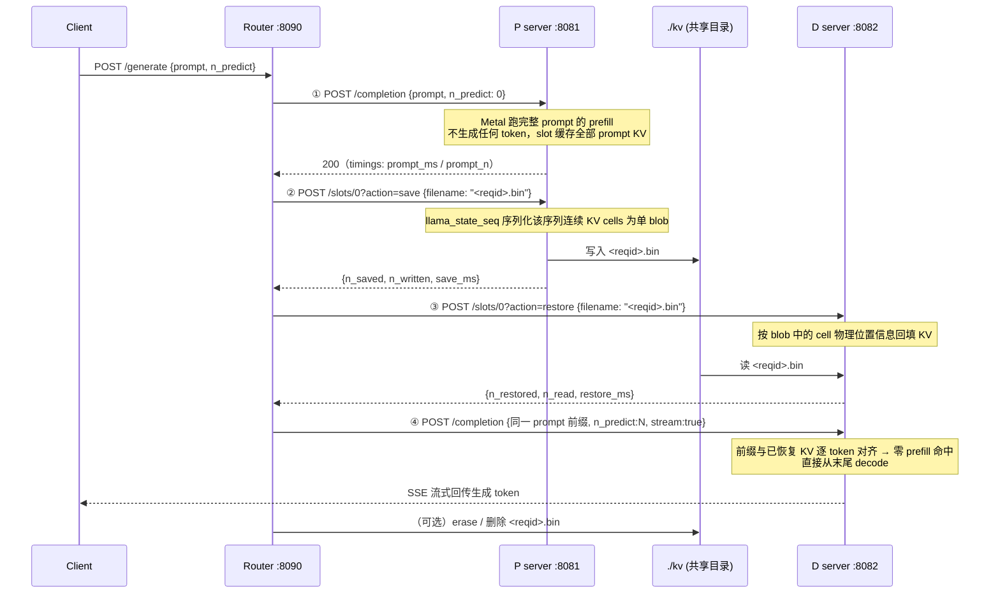

# 方案 002：单机简易 P/D 分离 —— llama.cpp/Metal 双实例 + KV 文件交接

> 状态：实现路径设计完成（2026-11-01），未开跑，整体 `not-verified`。
> 实验机：Mac Studio M1 Max / 64 GB / macOS 15.7.3。
> 评审底稿（为什么要做、比例经济学、12 方案对比、E0–E4 设计）： [review.md](review.md)。
> 上游 issue 取证（ggerganov 设计、POC 作者实测、社区 Mac 集群先例）：私有学习仓
> `bestksl/Learn001` 的 `docs/mac-pd-options.md`。

## 1. 一句话方案

在同一台 Mac 上起**两个完全对等的 llama-server（Metal）**：P 端只做 prefill（`n_predict:0`），
随后通过 llama.cpp 正式版自带的 **slot KV save/restore HTTP 端点**把该请求的 KV cache
存成文件；D 端从文件 restore，随后带着同一 prompt 前缀发起生成请求——前缀全部命中已恢复的
KV，**不重算 prompt，直接进入 decode**。一个约百行的 Python router 编排这四步。
这是真 P/D（角色分离 + KV 真实迁移），交接介质是本地文件而非 RDMA，定位是生产形态的
本机零成本预演。

## 2. 组件拓扑



两个 server 加载**同一个 GGUF、同一套上下文参数**（KV 布局必须一致）；模型权重在内存中
各存一份（不可避免，issue #21266 中 ggerganov 确认）。router 无状态，状态全部落在
slot 文件与请求 ID 上。

## 3. 一个请求的完整时序



**为什么第 ④ 步还要再发一次完整 prompt**：restore 只恢复 KV，不替 slot 提交任务；D 端收到
带有同一前缀的 completion 请求后走自己的 prompt-cache 匹配，全部前缀命中、不产生 prefill
计算，直接 decode。这一路径的正确性基准是 temp=0 时输出与单体 server 一致（POC 作者在
loopback RPC 方案上验证到逐 bit 一致；文件交接路径的一致性由本方案实测确认）。

## 4. KV 交介质：slot 文件里有什么、多大、多快

- 内容：llama.cpp 把该序列在物理 KV 池中占据的连续 cell 段扫描出来打成**单个 blob**
  （state_get/set 逻辑尊重 cell 物理布局，issue #21266 评论有代码位置），含 token 序列元数据，
  不是整池 dump。
- 量级（loaded-only，官方 server README 示例）：1,745 token → 14,309,796 字节，
  约 **8 KB/token**；同例 save 49.9 ms / restore 42.9 ms（小模型）。14B 的 KV 更宽
  （40 层、GQA、f16），**每 token 字节数以本实验 `n_written/n_saved` 实测为准**，
  不沿用小模型常数外推。
- 权重 Q4 不等于 KV Q4：KV 默认 f16；可把 `--cache-type-k/q`（q8_0、q4_0）列为实验变量，
  直接缩小 blob 与交接耗时。
- 交接是**顺序的、不能与 prefill 重叠**（文件方案的固有代价；issue 中 POC 作者实测
  千兆网约 10 s/GB）。同机走本地盘没有网络项，但序列化时延仍在——这正是要测的开销，
  也是 E3「假 P/D 对照」求净收益拐点的输入：短 prompt 净亏、长 prompt 才可能净赚。

## 5. 落地形态（设计示意，不是 runbook；实测后固化）

```
./pd-lab/
├── models/DeepSeek-R1-Distill-Qwen-14B-Q4_K_M.gguf   # 两端共用同一文件
├── kv/                                                # --slot-save-path 指向这里
├── logs/p.log  logs/d.log
├── llama-server        # 同一构建产物（Metal；正式版含 slot 端点，落地时核版本）
└── pd-router.py        # 编排四步 + 计时 + 一致性校验
```

进程如何起（参数为设计意图；端口/路径后续按实测调整）：

```bash
# P 端：prefill 专用，单 slot 先跑通
./llama-server -m models/14B-Q4.gguf -ngl 99 -c 32768 -np 1 \
  --host 127.0.0.1 --port 8081 --slot-save-path ./kv

# D 端：decode 专用，模型与上下文参数必须逐字一致
./llama-server -m models/14B-Q4.gguf -ngl 99 -c 32768 -np 1 \
  --host 127.0.0.1 --port 8082 --slot-save-path ./kv
```

router 四步调用（伪代码，实际 ≤200 行）：

```python
def generate(prompt, n_predict):
    http(P, "/completion", {"prompt": prompt, "n_predict": 0})                    # ①
    http(P, "/slots/0?action=save",   {"filename": f"{rid}.bin"})                 # ②
    http(D, "/slots/0?action=restore",{"filename": f"{rid}.bin"})                 # ③
    return stream(D, "/completion", {"prompt": prompt, "n_predict": n_predict,
                                     "stream": True, "temperature": 0})           # ④
```

实现时的已知注意点（`not-verified` 清单，踩中即记录）：

1. 第 ① 步完成后要**立刻** save：默认开启的 idle-slots 机制可能把冷 slot 换出；
2. 两端 prompt 必须**逐 token 一致**，router 只传同一字符串，不做任何加工；
3. slot 编号在 `-np 1` 下固定为 0；多 slot/多 D 是阶段 2 的事；
4. sampler/RNG 状态是否随 slot 保存先不假设，正确性阶段固定 temp=0；
5. restore 后第 ④ 步是否真的零 prefill，以 D 端返回的 `timings.prompt_ms`/`prompt_n` 为准；
6. llama.cpp 版本：slot save/restore 已在正式版（master README 有文档），RPC 流式 P/D
   仍是未合并 draft（方案 A3，阶段 3 才碰）。

## 6. 分阶段（先跑通一半）

| 阶段 | 形态 | 验收 |
| --- | --- | --- |
| **阶段 1（本次先做）** | 1:1、单请求、单 slot、同机同盘，14B Q4 | 跑通四步；D 端 `prompt_n` 命中、temp=0 输出与单体一致；拿到 blob 字节/token、save_ms、restore_ms、端到端 TTFT |
| 阶段 2 | 1:1 与 **1:2** 配比 + 并发扫点；KV q8/q4 变量 | 评审中 H2/H3 的证实/证伪数据；与单体、假 P/D 三组对照的拐点曲线 |
| 阶段 3 | CPU(P) `-ngl 0` / GPU(D) 异质分工（H1）；跨机 scp；跟踪 draft PR #24901 的流式交接 | 异质跨后端 restore 兼容性排雷；两机拓扑 |

实验序列 E0–E4 与扫点表沿用 [review.md](review.md) 第 3 节；结果写入本目录
`results-stage1.md`（跑通后再建，不预写）。

阶段 1 的可运行脚手架已落地在 [pd-lab/](pd-lab/)：`serve.sh` 起 P/D/baseline 三个
llama-server，`router.py` 跑四步编排，`bench.py check` 即上面三项验收；
不含 llama.cpp 也可先 `python3 router.py --selftest` 用假后端验证编排逻辑。

## 7. 边界与证据

- `not-verified`：以上全部行为在本机实测前均为设计；尤其「restore + 再请求」的零 prefill
  语义、save 时序与 idle-slot 的相互作用、14B 的每 token blob 大小。
- 单颗 GPU 上 1:2 **不带来算力**（评审 H1–H3）；阶段 1 的产出是协议与开销数据，不是性能提升。
- 数字不外推到手机 SoC（仓规）；本方案与方案 001 互补：001 用重塑问题回避自回归，
  002 研究保留自回归时云技术在单机的成立条件。
- 不引入 Mooncake/NIXL/RDMA（Linux 生态），不碰 V4.1-Flash（Learn001 兼容性判定）。
